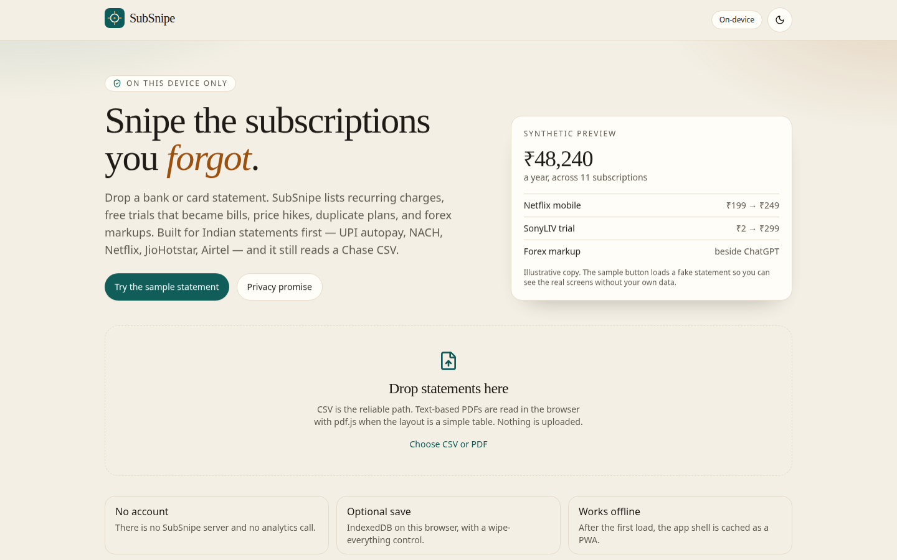
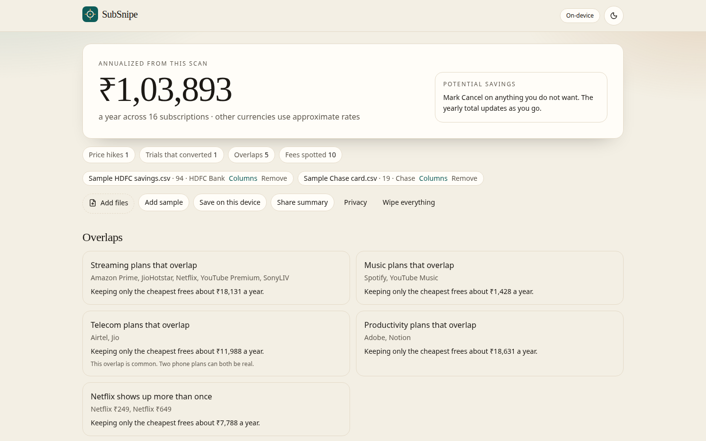

# SubSnipe

Find the subscriptions hiding in a bank or card statement. The file never leaves your browser.

**[Open the live demo](https://krish9219.github.io/subsnipe/)** · no account, no upload.



## Privacy promise

SubSnipe is a static site.

- Parsing, detection, and the share card run in the tab. There is no SubSnipe server.
- There is no analytics, no ads, and no third-party script. The production [content security policy](src/lib/csp.ts) is `script-src 'self'` and `connect-src 'self'`.
- Save is optional and uses IndexedDB on that device. **Wipe everything** deletes it.
- The summary PNG omits merchant names unless you opt in. It never includes narrations or account numbers.
- After the first visit the app shell is cached, so it opens offline.

## What you get



- Drag in several CSVs. Columns for date, narration, amount, and debit/credit are detected, with a manual mapping when they are not. Presets cover HDFC, ICICI, SBI, Axis, Kotak, Chase, and a generic debit/credit layout.
- Text-based PDFs are read with pdf.js when a simple table is actually in the file. Scans are not.
- A **sample statement** (synthetic HDFC savings plus a Chase card) so you can try it with no data of your own.
- Recurring charges (monthly, quarterly, yearly), price hikes, trials that became paid plans, duplicate plans, and forex or markup lines.
- A yearly total, Keep / Cancel / Unsure, and the before/after if you cancel what you marked.
- Cancel guides for popular services, with official links. India-first narrations (UPI autopay, NACH, Netflix, JioHotstar, Airtel, Jio) and common international ones.
- Light and dark themes, keyboard access, and a layout that works on a phone.

## How detection works

Everything interesting is a pure function in [`src/lib`](src/lib), covered by synthetic fixtures.

1. **Normalize.** Narrations are matched to [`src/data/merchants.json`](src/data/merchants.json). The longest alias wins, on word boundaries, so `JIO HOTSTAR` is not a Jio recharge and `SWIGGY ORDER` is not Swiggy One.
2. **Recurrence.** Charges for one merchant and currency are grouped into tracks. Gaps of about 30, 91, or 365 days become a cadence. A small amount jitter stays on the same plan. A lasting step up is a price hike. Two different amounts in the same month stay two plans.
3. **Evidence.** Unknown merchants need three consistent charges, or two when the line looks like a mandate. A single charge counts only for a known subscription brand, and it is marked low confidence. Salary, ATM, EMI, loans, and mutual-fund SIPs are skipped. One-off food orders and marketplace purchases do not become subscriptions.
4. **Trials and fees.** A tiny or “trial” charge followed within 45 days by the real price is a conversion. Forex, markup, cross-border, and convenience fees are listed on their own and tied to a subscription within three days when one is there.
5. **Money.** Cards stay in their own currency. The yearly headline converts other currencies with a static table in [`src/lib/money.ts`](src/lib/money.ts), labeled as approximate. It is not a live rate and not advice.

## Add a merchant, a bank, or a cancel guide

That dataset is how this project grows. The short version is in [CONTRIBUTING.md](CONTRIBUTING.md).

- **Merchant:** add an entry to `src/data/merchants.json` and a descriptor case in `src/data/alias-cases.json`. Keep aliases specific.
- **Bank format:** add a preset to `src/data/bankFormats.json` and a two-row synthetic CSV in the parser tests. Or open [Add my bank format](https://github.com/krish9219/subsnipe/issues/new?template=add_bank_format.yml).
- **Cancel guide:** add `content/guides/<id>.md` with an official `https` link and steps you checked. Or open [Add a cancel guide](https://github.com/krish9219/subsnipe/issues/new?template=add_cancel_guide.yml).

## Develop

```bash
npm install
npm run dev
npm run check          # prettier, eslint, tsc, vitest
npm run test:e2e       # playwright, sample-statement flow
npm run build          # VITE_BASE=/subsnipe/ for GitHub Pages
```

Stack: Vite, React, TypeScript (strict), Tailwind, a small shadcn-style component set, Framer Motion. pdf.js is loaded only if you drop a PDF.

## Deploy

GitHub Actions runs lint, types, unit tests, Playwright, and a production build on every pull request. Pushes to `main` also deploy to GitHub Pages.

**One-time repo setting:** Settings → Pages → Build and deployment → Source: **GitHub Actions**. Until that is set, the deploy job cannot publish. The demo URL is [https://krish9219.github.io/subsnipe/](https://krish9219.github.io/subsnipe/).

## Roadmap

- More Indian bank and card presets, driven by the issue template rather than one-off parsers.
- A clearer “this might be rent or an EMI” bucket, still off by default.
- Richer PDF table reconstruction for multi-column statement layouts.
- Import from pasted text when a bank only offers a print view.
- Locale-aware cancel guides (India UPI versus US app-store billing) as separate files per service.

## Limits

Detection is a heuristic. A loan EMI can look monthly. A single month of history is a weaker read than a year, and known brands with one charge are marked that way. PDF extraction only sees text embedded in the file, not a photographed statement. Exchange rates in the yearly total are a fixed display table. Nothing here is financial advice.

## License

[MIT](LICENSE) © 2026 Aravind Pilla
